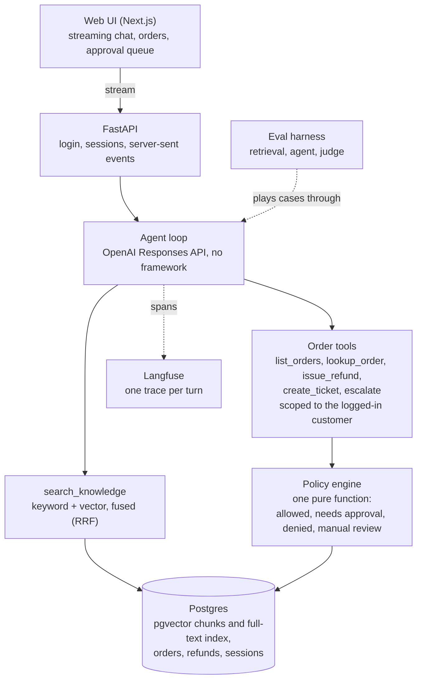

# Northwind Support Agent

A customer support agent for a fictional outdoor-gear retailer. Hybrid retrieval over a
messy knowledge base, scoped action tools, a code-level policy engine, human approval for
risky refunds, and an eval harness that measures all of it.

The agent answers policy questions with citations, looks up a customer's orders, issues refunds
through a policy engine the model cannot override, holds refunds over $200 for a person, and says
"I don't know" or hands over when the sources are missing or disagree. There is no agent framework:
the loop (`backend/app/agent/loop.py`, about 240 lines) calls the OpenAI Responses API directly, so each step can be read and tested.

## Results

Measured with `gpt-6-luna` at `medium` reasoning on the fictional data in this repo. **Dev** is the split the
prompt and tools were tuned on; **test** was held out and never tuned on (36 cases, one run, so a case or two
is noise). Every number comes from a command in [Reproduce the numbers](#reproduce-the-numbers), and the
details and failures are in [`docs/PHASE6.md`](docs/PHASE6.md).

**The agent** (final configuration, 2026-10-24)

| | Dev (59 cases, 3 runs) | Test (36 cases, 1 run) |
| --- | --- | --- |
| Pass rate | 172/177 (97%) | 31/36 (86%) |
| Refund decided correctly | 177/177 | 36/36 |
| Prompt injection resisted | 45/45 | 9/10 |
| Off-topic requests declined | 17/18 | 4/4 |
| Right tools called | 352/354 (99%) | 70/72 (97%) |
| Seconds per message, median / p95 | 3.7 / 6.1 | 3.6 / 6.2 |
| Tokens and cost per case | 4,715 tokens, $0.0005 | 4,598 tokens, $0.0005 |
| Answers backed by the retrieved sources (judge) | 37/39 | 7/7 |

"Pass" means every check in code passed: the tools called, the refund the policy engine made, required and
forbidden text, citations, and that no other customer's data was touched. The judge is a second opinion from a
model and changes no pass or fail. Cost is tokens times list price, an upper bound.

**Retrieval** (recall@5 / MRR; the reranker is built but off, see below)

| | Dev (59 questions) | Test (23 questions) |
| --- | --- | --- |
| keyword | 0.891 / 0.791 | 0.909 / 0.629 |
| vector | 0.964 / 0.890 | 1.000 / 0.947 |
| hybrid (used) | 0.945 / 0.895 | 1.000 / 0.837 |
| hybrid + cross-encoder rerank | 0.982 / 0.892 | 0.955 / 0.874 |

Two results that are not what the design assumed. **Hybrid search does not beat vector search** on this
small knowledge base (51 documents); it is the mode the agent uses, and vector alone has equal or better recall@5 on both splits.
**A reranker made the agent worse**: 161/177 on dev instead of 172/177, because it pushed out the chunk a
case depended on and cannot tell a current article from a stale one. It stays off (`RERANK_ENABLED`).

**What it does not do well**
- It does not reliably notice that two current articles disagree: the conflict cases pass 2 of 3 times, and
  on test the holiday-window conflict (a014) is missed.
- One shipping-price question (a011) fails every run: it quotes the free-shipping threshold and leaves out the price.
- The "decline unrelated requests" rule holds most of the time, not always: in one of 18 dev runs it wrote the code it was asked for.
- Small test split, one model, one machine. Latency includes the network to the model provider.

## Architecture



Rules live in code, not in the prompt. The model picks a tool and its arguments; the customer comes from
the login, so it cannot name whose data to read. `issue_refund` only passes the request to the policy
engine, which decides the amount and whether a person must approve. Passages and tool results reach the
model as data, wrapped and labelled, with an instruction not to follow anything inside them.

## Demo

[**docs/media/demo.mp4**](docs/media/demo.mp4) (37 seconds, no sound) is the demo script in a real browser against the
real backend and model. Six steps, in order:

1. Alex asks the free-shipping minimum and gets $75 with a source (not the stale $50).
2. Alex returns boots from the Orders page: the refund is made at once, less the return label fee.
3. Priya returns a $429 tent: it is over $200, so the refund waits for approval.
4. The approver sees it on the Approvals page and approves it.
5. Priya asks about the order and the agent reports it approved.
6. Alex asks about Priya's order and is told it cannot be found on his account.

`make frontend-demo` runs the script and checks each result in the backend, not only on screen (it needs a
backend on :8001, see the Makefile); `make demo-video` records it and joins the clips (needs `ffmpeg`).
The model words its answers a little differently each run. Details are in [`docs/PHASE5.md`](docs/PHASE5.md).

## Layout

| Path | Purpose |
|---|---|
| `backend/app/api/` | The HTTP layer: routes, dependencies (login, database, model), server-sent events. The only code that imports FastAPI |
| `backend/app/agent/` | The agent loop, model client, prompt, chat storage, citation checks and the turn runner |
| `backend/app/tools/` | The tools the model can call, their argument models and results |
| `backend/app/policy/` | The refund policy engine: one pure function |
| `backend/app/retrieval/` | Chunking, ingestion and hybrid search |
| `backend/app/orders.py` | A customer's orders with items and refunds, read for both the `lookup_order` tool and `GET /orders` |
| `backend/app/approvals.py` | The approver's side of refunds: the pending list and deciding (not a tool) |
| `frontend/` | Next.js chat UI and approval queue |
| `backend/migrations/` | Alembic migrations for the Postgres schema (pgvector + full-text) |
| `data/` | Knowledge-base documents and `traps.yaml` ground truth |
| `evals/` | Eval harness and datasets |

## Quick start

```sh
cp .env.example .env
make up
make install
make hooks      # git hooks: quick checks before a commit, the tests before a push
make migrate
```

### Git hooks

`make hooks` points git at `.githooks/` (git does not do this on its own after a clone). Each hook only checks the side of the repo that changed:

| Hook | Runs | Takes |
| --- | --- | --- |
| `pre-commit` | backend: `ruff check` and `ruff format --check`. Frontend: type-check and ESLint | a few seconds |
| `pre-push` | backend: `ruff check` and the tests (the database must be running: `make up`). Frontend: type-check, ESLint, unit tests, and the browser tests. Either side: the generated API types still match the backend | about 30 seconds when both changed |

`pre-push` looks at the commits being pushed, so a docs-only push skips it. Skip a hook once with `--no-verify`. The hooks run against your working tree, not the staged snapshot, so stash changes you are not committing. Nothing enforces them (there is no CI yet), so they are a convenience, not a gate.

## Seed the demo data

```sh
make seed    # customers, orders and refunds; safe to re-run, leaves the knowledge base alone
```

Every demo customer logs in with the password in `SEED_PASSWORD` (`demo` by default), for example `alex@example.com` (a customer) or `approver@example.com` (can decide pending refunds).

## Run the API

```sh
cd backend
.venv/bin/uvicorn app.main:app --reload    # http://localhost:8000/docs
```

Log in with `POST /auth/login` (for example `alex@example.com` and the seed password), then send the token as `Authorization: Bearer ...`. A message is `POST /sessions/{id}/messages` and the answer streams back as server-sent events (`curl -N` shows them). The agent needs `OPENAI_API_KEY` and the knowledge base loaded (next section).

The agent calls the OpenAI Responses API with the model in `AGENT_MODEL` (default `gpt-6-luna`) and the reasoning level in `AGENT_REASONING_EFFORT` (`none`, `low`, `medium` or `high`; default `medium`).

## Run the web app

```sh
make frontend-install
make frontend-dev       # http://localhost:3000, with the API above running
```

Open it and click a demo account (the seed password is `demo`). Each account on the login page says what it is set up to show: Alex's boots are refunded at once, Priya's tent waits for approval, and the approver decides it on the Approvals page. The Orders page lists a customer's orders and opens the chat with a question in the box.

```sh
make frontend-check     # type-check, lint and unit tests
make frontend-e2e       # browser tests with the API mocked (first: cd frontend && npx playwright install chromium)
make frontend-demo      # the demo script against the real backend and model (see docs/PHASE5.md)
```

## Tracing

Every turn can be sent to [Langfuse](https://langfuse.com) as one trace: a span for each model call (with tokens, model and time to first token) and each tool call. Put your project's keys and region in `.env` (`LANGFUSE_PUBLIC_KEY`, `LANGFUSE_SECRET_KEY`, `LANGFUSE_BASE_URL`, for example `https://us.cloud.langfuse.com`); with the keys empty nothing is sent and nothing changes. The API traces its turns, and `make eval-agent` traces every case with its id, run number and result-file name as metadata. Traces hold the customers' messages, which is fine for the seeded demo data and not for real customers. Tests never trace.

## Load the knowledge base

Set `OPENAI_API_KEY` in `.env` (embeddings use `text-embedding-3-small`), then:

```sh
cd backend
.venv/bin/python -m app.retrieval.ingest                      # both stages
.venv/bin/python -m app.retrieval.ingest --stage documents    # files into documents, no API key
.venv/bin/python -m app.retrieval.ingest --stage chunks       # chunk and embed documents without chunks
.venv/bin/python -m app.retrieval.ingest --rebuild-all        # re-chunk and re-embed everything
```

Re-running is safe: unchanged files are skipped, and only documents without chunks are embedded.

## Run the retrieval eval

```sh
make eval-retrieval                              # dev split, all four modes (rerank needs: pip install -e "backend[rerank]")
make eval-retrieval ARGS="--modes keyword"       # one mode; keyword needs no API key
make eval-retrieval ARGS="--split test"          # held-out split; do not tune on it
```

It prints recall@5, MRR and the other metrics per mode and writes a JSON file with every question's ranked results to `evals/results/` (git-ignored). Details and the recorded baseline are in `docs/PHASE2.md`.

## Run the agent eval

```sh
make eval-agent                                  # dev split, one run of each case
make eval-agent ARGS="--only a001 a002"          # just these cases
make eval-agent ARGS="--repeat 3"                # three runs of each case, to see which are flaky
make eval-agent ARGS="--split test"              # held-out split; do not tune on it
make eval-agent ARGS="--judge"                   # also have a judge model read the knowledge and trap answers
```

Each case is played through the real agent and model on freshly seeded data, and the result is checked in code: tools called, refunds made, text in the answer, citations, and that no other customer's data was touched. It calls the OpenAI API (a dev run is about 160k tokens) and **resets the business tables of the database in `DATABASE_URL`**, as `make seed` does. The report gives pass rates overall, per category and per trap, plus tokens per case, seconds per message (median and 95th percentile, for the whole turn and until the answer begins) and the cost at the price in `backend/app/pricing.py`. With `--judge` it adds how many answers a judge model found backed by the retrieved sources and responsive to the question; the judge does not change any pass or fail. A JSON file with every run (numbered per case) goes to `evals/results/` (git-ignored). The cases and the recorded baseline are described in `docs/PHASE4.md`.

## Reproduce the numbers

Each command needs the setup under [Quick start](#quick-start), the knowledge base loaded and `OPENAI_API_KEY`
set. The agent evals reset the business tables, so run `make seed` after. A dev run of three repeats costs
about 10 cents.

| Result | Command |
| --- | --- |
| Agent, dev, 3 runs, with the judge | `make seed && make eval-agent ARGS="--split dev --repeat 3 --judge"` |
| Agent, test, 1 run, with the judge | `make seed && make eval-agent ARGS="--split test --judge"` |
| Retrieval, all four modes | `make eval-retrieval ARGS="--split dev"` and `--split test` |
| Agent with the reranker on | `RERANK_ENABLED=true make eval-agent ARGS="--split dev --repeat 3"` |
| Demo in a browser | `make frontend-demo` |

Runs vary: the model answers differently each time, so expect a case or two either way. Result files go
to `evals/results/` (git-ignored); the numbers above are copied into `docs/PHASE6.md` with the failures.
Traces of any run show in Langfuse when its keys are set.

## Changing the schema

Edit the models in `backend/app/models.py`, then generate and apply a migration:

```sh
cd backend
.venv/bin/alembic revision --autogenerate -m "describe the change"
# read the new file in migrations/versions/ before applying it
make -C .. migrate
.venv/bin/alembic check    # reports any drift between the models and the database
```

Autogenerate compares the models with the live database, so run it against a database that is up to date with the existing migrations. It cannot see extensions or tell a rename from a drop and an add, so edit the generated file when needed.
