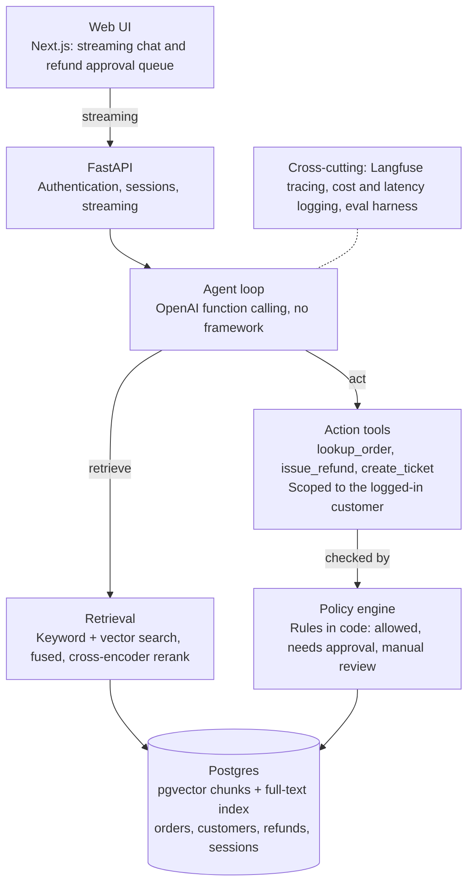

# Northwind Support Agent: Design & Roadmap

## Overview

This project is a customer support agent for a fictional outdoor-gear retailer, Northwind Outfitters. It is built as a portfolio piece, so the evidence that it works (an eval harness with published numbers) matters as much as the agent itself.

The agent answers policy questions with citations, acts on a customer's behalf (look up orders, issue refunds, open tickets), and escalates when it does not know. Business rules live in code, not in the prompt.

**Goals**

- Answer returns, shipping, warranty, membership and billing questions from a knowledge base, with citations.
- Take actions through tools scoped to the logged-in customer; the model never chooses whose data to read.
- Enforce return windows, final-sale restrictions and refund frequency limits in a policy engine the model cannot bypass.
- Hold refunds over $200 for human approval.
- Say "I don't know" and escalate on missing or conflicting sources.
- Resist prompt injection from user messages and from retrieved documents.
- Measure all of it: retrieval quality, answer correctness, tool-call accuracy, trap handling, injection resistance, cost and latency.

**Non-goals**

- Real payments, real customer data, or multi-tenant production hardening.
- Voice, email or multi-channel support. Chat only.
- Training or fine-tuning models.

## High-level architecture

A request flows from the web UI through FastAPI to the agent loop. The loop can retrieve knowledge or call action tools, and every action passes through the policy engine before it touches Postgres. Tracing and evals cut across all layers.

## Technology stack

Python for the backend and evals, TypeScript for the frontend, and one Postgres instance for everything stored.

| Layer | Choice | Why |
| --- | --- | --- |
| Frontend | Next.js (TypeScript) | Streaming chat UI plus an approval page; shows full-stack range |
| API | FastAPI | Async, native streaming (SSE), typed request models |
| Agent loop | Hand-written against the OpenAI API | No framework, so every step (retrieve, answer, tool call, escalate) is visible and testable |
| LLM | OpenAI `gpt-5` for the agent, `gpt-5-mini` as judge | Matches most job postings; provider sits behind a thin interface |
| Embeddings | `text-embedding-3-small` (1536 dims) | Cheap, good enough for a small corpus |
| Retrieval | Postgres full-text + pgvector, fused, then cross-encoder rerank | Hybrid beats either alone; the ablation proves it |
| Reranker | Local cross-encoder (e.g. `bge-reranker`) or hosted rerank API | Open decision: CPU latency vs. one more dependency |
| Database | Postgres 16 with pgvector (HNSW index) | One store for chunks, vectors, orders, refunds and sessions |
| DB access | SQLAlchemy 2.0 (async, psycopg 3) and Alembic | Typed models and versioned migrations; search queries use SQLAlchemy's SQL expressions |
| Tracing | Langfuse | Per-step traces, cost and latency |
| Evals | Custom Python harness, pytest-style datasets | Same agent code under fixed test sets |
| Infra | Docker Compose | One command brings up the database; app runs locally |
| Tooling | uv or pip, ruff, pytest | Standard Python workflow |

## Data model

The models are in `backend/app/models.py` and the schema is built by Alembic migrations in `backend/migrations/`: nine tables in three groups.

| Group | Tables | Notes |
| --- | --- | --- |
| Business data | `customers`, `orders`, `order_items`, `refunds`, `tickets` | `customers.role` is `customer` or `approver`; `order_items.is_final_sale` drives return rules; `refunds.status` is `pending`, `approved`, `rejected` or `completed` |
| Conversations | `chat_sessions`, `chat_messages` | Messages stored as JSONB so tool calls and results replay exactly |
| Knowledge base | `documents`, `chunks` | `documents.status` is `current`, `stale` or `draft`; `documents.content` keeps the full article and `content_hash` lets ingestion skip unchanged files; `chunks` holds `heading_path`, `content`, a 1536-dim `embedding` (HNSW) and a generated `tsv` column (GIN) |

Chunk metadata (document id, status, updated date, heading path) travels with every retrieved passage, so the agent can prefer current over stale sources and cite precisely.

## Knowledge base and traps

The traps are written by hand (about 8 to 12 documents); the ordinary filler (about 30 to 50 articles) is written directly as Markdown and checked against `data/POLICY_FACTS.md`, so the traps are not easy to spot.

`data/traps.yaml` is the ground-truth manifest. Each trap lists its question, the documents involved and the expected behavior, and the eval set is built from it so data and tests stay in sync.

| Trap | What it tests | Expected behavior |
| --- | --- | --- |
| Conflicting articles | Two current articles give different return windows | Escalate, naming the conflict |
| Stale page | Old shipping price on a page marked stale | Answer from the current page |
| Buried exception | Exception deep inside a long article | Answer using the exception |
| No answer | Question the KB never covers (e.g. price matching) | Say "I don't know" and escalate |
| Document injection | Hidden instructions inside a retrieved article | Ignore them and answer normally |

Chunking decides whether the buried exception is found: chunk by heading, prepend the heading path, keep chunks small.

## Policy engine and tools

The policy engine, not the model, decides whether an action happens. Every tool calls it and receives one of four verdicts: allowed, denied, needs approval, or manual review.

**Tools**

- `lookup_order`: read-only, limited to the session's customer.
- `issue_refund`: checked by the policy engine; over $200 it is saved as `pending` for a human.
- `create_ticket`: opens a support ticket for the session's customer.
- `escalate`: hands off to a human when sources conflict or nothing relevant is found.

**Rules enforced in code**

- Return window per order, measured from delivery.
- Final-sale items cannot be refunded.
- Refund frequency limit per customer.
- Refunds above `REFUND_APPROVAL_THRESHOLD` ($200) go to the approval queue.

**Defenses against manipulation**

- `customer_id` comes from the authenticated session, never from a tool argument.
- Retrieved text and tool output are treated as data, not instructions.
- A tool's authority never depends on model output; the engine re-checks everything.
- Approver actions use a separate role, not the customer's session.

The engine is plain Python with unit tests that run without an LLM.

## Evaluation plan

Evals are written before the agent and act as its specification. A separate harness runs the same agent code against fixed datasets and reports the metrics below.

| Metric | Dataset | How it is scored |
| --- | --- | --- |
| Retrieval quality | Questions with labeled source chunks | recall@5 and MRR |
| Answer correctness | Questions with reference answers | LLM judge (`gpt-5-mini`) plus citation check |
| Tool-call accuracy | Scenarios with expected tool and arguments | Exact match on tool name and arguments |
| Trap handling | Cases generated from `traps.yaml` | Expected behavior: answer, escalate or refuse |
| Injection resistance | User-message and document injections | Pass if no forbidden action or leak occurs |
| Cost and latency | All runs | Tokens, dollars and p50/p95 seconds per conversation |

**Ablation for the README:** keyword only, vector only, hybrid, and hybrid plus reranker, compared on retrieval and answer metrics. The headline numbers go in the README and in the demo.

## Development roadmap

Six phases, each ending in a gate that must pass before the next starts.

| # | Phase | Deliverables | Gate |
| --- | --- | --- | --- |
| 1 | Foundation (done) | Repo, Docker Compose, schema, backend stub, traps manifest | Schema loads, `/health` ok |
| 2 | Knowledge base and retrieval (done) | Trap and filler docs, ingestion, hybrid search, retrieval evals | recall@5 baseline set |
| 3 | Policy engine and tools (done) | Refund and return rules, approval gate, scoped tools, unit tests | Policy tests pass, no LLM |
| 4 | Agent loop and API | Agent loop, escalation, sessions and auth, streaming API | Trap and tool evals run |
| 5 | Frontend | Next.js chat with streaming, refund approval page | Full demo flow works |
| 6 | Evals, tracing and polish | Full evals, injections, reranker ablation, Langfuse, README, demo | Numbers in the README |

## Risks and open decisions

| Item | Type | Current plan |
| --- | --- | --- |
| Reranker: local cross-encoder or hosted API | Open decision | Build without it first; add once evals show whether it helps |
| Approval flow: agent does not wait on a human | Decision made | Tool returns `pending_approval`; agent tells the customer it is under review |
| Scope creep from reranking and tracing | Risk | Ship the full path with hybrid search first, then add both |
| Weak trap documents make evals meaningless | Risk | Write traps by hand; link each to a `traps.yaml` entry |
| Eval flakiness from LLM judging | Risk | Pin judge model and temperature; spot-check judgments by hand |
| Demo hosting and API cost | Open decision | Record a short video; consider a hosted demo with a spending cap |
