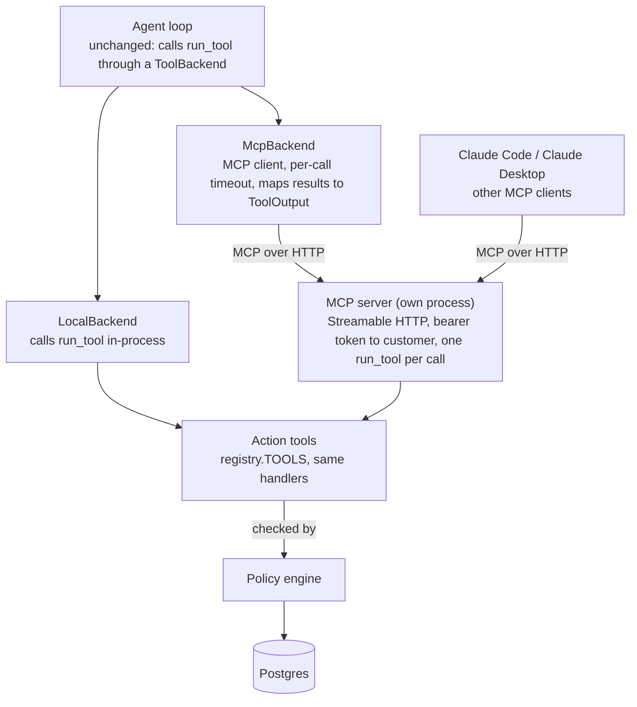

# Northwind Support Agent: MCP Tool Server Design & Roadmap

## Overview

This extends the support agent (see `DESIGN.md`) by moving its action tools behind a Model Context Protocol (MCP) server. Today the tools are Python functions the agent loop calls in-process. After this work the same tools are a standalone server that the agent, Claude Code and Claude Desktop can all use.

It is also groundwork for a later project: a personal agent with long-term memory that reads email and calendar through other MCP servers. This project settles the hard parts first (identity, side effects over a network, receipts, timeouts) on tools that already have evals.

The rule for the whole change: **behavior does not change.** The eval pass rates through MCP must match the in-process path.

**Goals**

- Expose `search_knowledge`, `list_orders`, `lookup_order`, `issue_refund`, `create_ticket` and `escalate` as MCP tools, with the schemas and descriptions the model sees today.
- Keep the customer out of the tool arguments: the server learns who is calling from the connection's credentials.
- Keep `decide_refund` and every approver action unreachable from MCP.
- Let the agent loop use either backend (`TOOL_BACKEND=local|mcp`) with no change to the loop's logic.
- Say honestly when the outcome of a call is unknown (a timeout after a possible commit), and never claim "nothing was changed" in that case.
- Prove equivalence: the same tool tests and agent evals pass on both backends.

**Non-goals**

- Gmail, Calendar or memory servers. Those are the next project.
- Multi-tenant production hardening, rate limiting, or a public hosted server.
- MCP resources and prompts. Tools only.
- Replacing the in-process path. It stays as the default and as the test baseline.

## High-level architecture

The server is a thin wrapper around `run_tool`, so validation, the transaction per call, the error mapping and the policy checks are the code that already exists and is already tested. The server adds three things: authentication, the mapping of `ToolOutput` onto an MCP result, and the context (session, clock, embedder) that the agent used to pass in.

## Technology stack

| Layer | Choice | Why |
| --- | --- | --- |
| Protocol | MCP, Streamable HTTP transport | Serves several customers over one process; stdio would need a process per customer |
| Server | Official MCP Python SDK, run as its own process (`python -m app.mcp_server`, port 8765) | A real service boundary, so timeouts and unknown outcomes are testable; imports `app.config`, `app.db`, `app.auth` and `registry.TOOLS` from the backend package, so no code is copied |
| Client | The same SDK's client, in a `McpBackend` | Same protocol Claude Code speaks, so one server is tested from both |
| Auth | The existing signed token (`app/auth.py`) as `Authorization: Bearer` | The token already holds only the customer id and an expiry; role and membership are read from the database on each call |
| Tests | The SDK's in-memory transport | Runs the existing tool tests and eval cases through the protocol with no network |
| Tooling | uv or pip, ruff, pytest | Unchanged |

## Contracts

The code that touches tools depends on `ToolOutput(text, status, receipt)` and `tool_schemas()`. Both stay. MCP is mapped onto them like this:

| Agent side | MCP side |
| --- | --- |
| `ToolSchema.name`, `description` | Tool `name`, `description` |
| `ToolSchema.parameters` | Tool `inputSchema`, unchanged (`extra="forbid"` still applies) |
| `ToolOutput.text` | The result's text `content`, byte for byte (`add_retrieved` parses it for citations) |
| `ToolOutput.status` | `_meta.status`; `isError` is set for `invalid_request` and `error` |
| `ToolOutput.receipt` | `_meta.receipt`. The model must never see it, so it is not in `content` |
| `ToolContext.customer_id` | Resolved by the server from the bearer token |
| `ToolContext.session`, `clock`, `embedder` | Owned by the server; the clock is injectable for tests |

The tools list is built from `registry.TOOLS` only, so a tool that is not in `TOOLS` (`decide_refund`) cannot be served.

## Deployment

The server is a separate process from the chat API. It is not mounted in FastAPI and does not use it.

- **Run it** with `make mcp` (`python -m app.mcp_server`), next to the API. The API starts without it as long as `TOOL_BACKEND=local`, which stays the default, so the chat API, the demo and the existing tests need one process only.
- **Shared with the API:** the Postgres database and `JWT_SECRET`. Both processes must use the same secret or every token is refused.
- **Not shared:** the server has its own DB pool, its own embedder for `search_knowledge`, and its own settings load.
- **Config:** `MCP_SERVER_URL` for the client, `MCP_PORT` for the server, `MCP_CALL_TIMEOUT_SECONDS` for the client.
- **Hosting is not baked in.** The server code takes its config from settings and does not assume how it is started, so mounting it in the API later is a small change if a single deploy is wanted.

## Identity and side effects

**Customer identity.** The tool arguments have no customer field and reject unknown ones. Over MCP the customer comes from the token on the connection. An invalid or expired token gets no tool list and no calls. The agent opens its connection with the logged-in customer's token and never reuses one across customers.

**Outcome unknown.** `run_tool` can say "nothing was changed" because it rolls back on failure. Over a network that claim is false after a timeout, because the server may have committed. The client therefore has a third outcome, `unknown`, with its own message ("The result of this step is unknown; it may or may not have been done") and a receipt-style note for the customer, so the loop's failure-after-action messages stay truthful.

**No tool retries.** The loop retries model calls that failed before showing anything, never tool calls, and that stays true. `issue_refund` has no idempotency key, so a retried call after an unknown outcome could refund twice. A key is a possible later change, not part of this project.

**Timeouts.** Each MCP call has its own timeout (`MCP_CALL_TIMEOUT_SECONDS`), and the turn deadline covers the extra hop. A tool call that outlives its timeout counts as `unknown`.

**Defenses carried over**

- Retrieved text and tool output are still data, not instructions. MCP does not change what the model is told.
- The policy engine re-checks every refund on the server, as before.
- Tool descriptions come from the registry, not from the connection, so a client cannot change what the server tells a model.
- Logs and traces keep customer ids, not names or emails, as before.

## Evaluation plan

The evals are the specification. They already exist, so the plan is to run them through the new path and compare, not to write new ones first.

| Check | How it is scored |
| --- | --- |
| Tool tests through the protocol | `test_tools.py` cases run against the in-memory MCP transport and give the same results as `run_tool` |
| Schema equivalence | The `inputSchema` for every tool equals `tool_schemas()` output |
| Identity | A call with no token, a bad token and an expired token is refused; a call cannot reach another customer's order; `decide_refund` is not listed |
| Receipts | A refund over MCP gives the same `receipt` and status; the receipt is absent from `content` |
| Failure handling | A forced timeout after commit gives `unknown`, never "nothing was changed"; the failure-after-action message names what was done |
| Agent eval, both backends | Dev and test splits with `TOOL_BACKEND=local` and `mcp`; pass rates must match within run-to-run noise |
| Cost and latency | Added seconds per tool call, median and p95, local versus MCP |
| Claude Code smoke test | The server connected to Claude Code, with a lookup and a refund done by hand |

The headline result for the README: pass rates equal on both backends, plus the measured latency cost of the hop.

## Development roadmap

Four phases, each ending in a gate that must pass before the next starts.

| # | Phase | Deliverables | Gate |
| --- | --- | --- | --- |
| 1 | Server | MCP server process over `TOOLS` (`app.mcp_server`, `make mcp`), token auth, `_meta` mapping, injectable clock, tool tests through the in-memory transport | Tool tests and identity checks pass; Claude Code can call it |
| 2 | Client and flag | `ToolBackend` interface, `LocalBackend`, `McpBackend`, `TOOL_BACKEND` setting, loop uses the interface | Existing tests pass unchanged on `local`; loop tests pass on `mcp` |
| 3 | Failure handling | Per-call timeout, the `unknown` outcome, loop messages for it, tests that force a timeout after commit | Failure tests pass; no path says "nothing was changed" after a timeout |
| 4 | Evals and docs | Agent eval on both backends, latency numbers, README section, the commands that reproduce them | Numbers in the README |

## Risks and open decisions

| Item | Type | Current plan |
| --- | --- | --- |
| Mount in the FastAPI app or run as a separate process | Decision made | Separate process; see Deployment. It costs one more thing to start, so `make mcp` and a note in the README |
| API and server configured with different `JWT_SECRET` values | Risk | The server refuses to start on the default dev secret outside local runs, and a test checks that a token made by the API is accepted by the server |
| Double refund after an unknown outcome | Risk | No tool retries; an idempotency key is a later change |
| Receipt leaking into `content` | Risk | A test that asserts the receipt is only in `_meta` |
| Citations break if the text is reformatted | Risk | `content` is the exact `ToolOutput.text`; a test compares them |
| SDK API changes between versions | Risk | Pin the version; keep the SDK use inside two small modules |
| Token lifetime on a long-lived MCP connection | Open decision | Check the token on every call, not only at connect |
| Eval noise hides a real difference between backends | Risk | Run dev three times per backend, as in phase 6 |
| Scope creep into Gmail, Calendar and memory | Risk | Out of scope here; this project ends at the README numbers |
