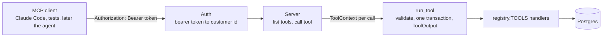

# Phase 7: MCP tool server

**Status:** planned
**Gate:** tool tests and identity checks pass through the protocol; Claude Code can call the server

This is phase 1 of `MCP_DESIGN.md`. The design says what the whole change is and why; this file says how the server is built.

## Goal

Run the agent's six tools as a separate MCP server process, with the same names, descriptions, argument schemas and results the model sees today. A client proves who it is with the signed token the API already issues, and the server runs each call as that customer. Nothing about the agent changes yet: the loop still calls the tools in-process. The client and the `TOOL_BACKEND` flag are phase 8.

By the end, a person can start the server with `make mcp`, connect Claude Code to it with a token, and look up an order or ask for a refund by hand. The same tools can be called from a test through an in-memory transport with no network.

## Deliverables

- [ ] **Server**: `backend/app/mcp_server/`, run with `python -m app.mcp_server`, serving every entry of `registry.TOOLS` over Streamable HTTP
- [ ] **Authentication**: a bearer token is required on every request, resolved to a customer with `read_token`; a missing, malformed or expired token is refused
- [ ] **Result mapping**: `ToolOutput.text` as the result's text content, byte for byte; `status` and `receipt` in `_meta`; `isError` for `invalid_request` and `error`
- [ ] **Server-owned context**: its own DB pool, embedder and clock; the clock is injectable so tests can fix the date
- [ ] **Settings**: `MCP_PORT` and, for later, `MCP_SERVER_URL`; both in `.env.example`
- [ ] **Make target**: `make mcp`
- [ ] **Tests**: the existing tool cases run through the in-memory transport, plus the identity, schema and receipt checks below
- [ ] **Claude Code check**: the server connected to Claude Code, with a lookup and a refund done by hand, written up under "Gate check"

## What the earlier phases already give

- `registry.TOOLS` is the single list of tools, and `tool_schemas()` already gives each one's JSON Schema without Pydantic's `title` keys. The server lists tools from these and nothing else
- `run_tool(ctx, name, raw_arguments)` validates the arguments, opens one transaction per call, rolls back on failure and returns a `ToolOutput`. The server calls it and adds no rules of its own
- The argument models use `extra="forbid"`, so a client that sends a `customer_id` gets `invalid_request` and nothing runs
- `app/auth.py` has `read_token` (customer id or `None`) and `to_current`, and the role and membership are read from the database on every request
- `ToolContext` takes a session, a customer id, a clock and an optional embedder, so the server only has to build one per call
- `decide_refund` is not in `TOOLS`, and the approval endpoints are in the API, not the registry. Neither can appear in the server unless someone adds it to `TOOLS`
- `tests/tool_world.py` builds seeded customers and a fixed clock, and the tool tests already run against it

## Architecture

The server is a thin layer. A request is authenticated, the customer is loaded, a `ToolContext` is built for that customer, `run_tool` runs, and the `ToolOutput` is mapped to an MCP result. Everything that decides whether an action happens is the code that already exists.

## Layout

| File | What it holds |
| --- | --- |
| `app/mcp_server/__init__.py` | Empty |
| `app/mcp_server/__main__.py` | Starts the server on `MCP_PORT`; refuses to start with the default dev `JWT_SECRET` unless told it is a local run (see decisions) |
| `app/mcp_server/server.py` | Builds the server: lists the tools from `TOOLS`, handles a call, builds the context |
| `app/mcp_server/auth.py` | Reads the bearer token from the request and returns a `CurrentCustomer` or refuses |
| `app/mcp_server/mapping.py` | `ToolOutput` to an MCP result and back. Plain functions with no SDK state, so phase 8's client uses the same file |

SDK calls stay inside `server.py` and `mapping.py`, so a change in the SDK touches two files.

## Mapping a result

| `ToolOutput` | MCP result |
| --- | --- |
| `text` | One text content item, the exact string. The loop's `add_retrieved` parses it for citations, so it is never reformatted |
| `status` | `_meta["northwind/status"]` |
| `receipt` | `_meta["northwind/receipt"]`, only when set. Never in `content`, because the model must not see it |
| `status` in (`invalid_request`, `error`) | `isError: true` |

The two `_meta` keys are named with a prefix so they cannot collide with the protocol's own keys. `mapping.py` also has the reverse function, used in phase 8, and a test checks that mapping a `ToolOutput` and mapping it back gives the same value.

## Authentication

- The token is read from the `Authorization` header of each request, not once per connection, so an expired token stops working at once
- `read_token` returns the customer id or `None`. The customer is then loaded from the database, so a deleted customer or a changed role takes effect on the next call
- A request with no valid token gets an HTTP 401 and sees no tool list
- Approvers are customers too. An approver's token gives the same six tools scoped to the approver's own account. The server has no approval tool, so there is nothing more to grant
- The token never appears in logs

## Context

Each call builds a fresh `ToolContext`:

- **Session**: from the server's own `SessionLocal`, one per call, because `run_tool` opens the transaction itself and needs a session that is not already in one
- **Embedder**: one `OpenAIEmbedder` made at start-up and reused. It is created only if `OPENAI_API_KEY` is set. Without it `search_knowledge` raises, and `run_tool` turns that into an `error` result, as it does today when a context has no embedder; the other five tools work
- **Clock**: `utc_now` by default; `create_server(clock=...)` takes another, which the tests use to fix the date at the world's `NOW`

## Configuration

| Setting | Default | Used by |
| --- | --- | --- |
| `MCP_PORT` | `8765` | The server |
| `MCP_SERVER_URL` | `http://localhost:8765/mcp` | The client, phase 8. Added now so `.env.example` is complete |

The server reads `DATABASE_URL`, `JWT_SECRET` and `OPENAI_API_KEY` from the same settings the API uses. Both processes must have the same `JWT_SECRET`.

## Tests

| Test | Checks |
| --- | --- |
| Tools through the protocol | The cases in `test_tools.py` that call `run_tool` give the same text, status and receipt when called through the in-memory transport |
| Tool list | The server lists exactly the keys of `TOOLS`; `decide_refund` and every approval action are absent |
| Schema equivalence | Each tool's `inputSchema` equals `tool_schemas()` for that tool |
| Identity | No token, a malformed token, a token signed with another secret and an expired token are all refused; a valid token for customer A cannot read customer B's order |
| Extra arguments | A call with a `customer_id` argument returns `invalid_request` and writes nothing |
| Receipt | A refund returns the receipt in `_meta` and not in `content` |
| Text is exact | `content` equals `ToolOutput.text` for a search that returns passages, so citations still parse |
| Mapping round trip | `ToolOutput`, to an MCP result, back to a `ToolOutput`, is unchanged |
| API token accepted | A token made by `create_token` in the API's code path is accepted by the server |
| Embedder missing | With no embedder the server starts, the other tools work and `search_knowledge` returns an error result, not a crash |

The tests run on the in-memory transport and the seeded test database, so they need Postgres but no network and no model.

## Build order

1. Add the MCP SDK to `pyproject.toml`, pinned, and check that it imports
2. `mapping.py` and its round-trip test, with no server yet
3. `server.py` listing the tools and running one call as a fixed customer, tested in memory
4. `auth.py` and the identity tests
5. `__main__.py`, the settings and `make mcp`
6. The remaining tests from the table
7. The Claude Code check, written into this file

## Gate check

| Check | Result |
| --- | --- |
| `pytest` | All tests pass, old and new |
| `ruff check` | Clean |
| Tool list | Six tools, none for approvals |
| Identity checks | The four bad tokens are refused |
| Claude Code | `claude mcp add` with the server URL and a token from `/auth/login`; a lookup and a refund made by hand give the same answers as the API |

## Decisions to confirm

- **What counts as a local run.** The server should not start on the default dev `JWT_SECRET` if it is exposed. Proposed rule: it starts on the default secret only when it listens on `localhost`, and refuses on any other address
- **Transport details.** Which of the SDK's HTTP helpers to use, and whether the endpoint is `/mcp`. Fixed once the SDK version is pinned in step 1
- **Token for Claude Code.** The API's login endpoint returns a token that lasts `TOKEN_TTL_MINUTES` (480). Fine for a manual check. A long-lived token for a person's own machine is a separate question and is not decided here

## Not in this phase

- The MCP client, `TOOL_BACKEND` and any change to the agent loop (phase 8)
- Per-call timeouts and the `unknown` outcome (phase 9)
- Agent evals on the MCP path and latency numbers (phase 10)
- Idempotency keys for `issue_refund`
- MCP resources and prompts
- Gmail, Calendar and memory servers
