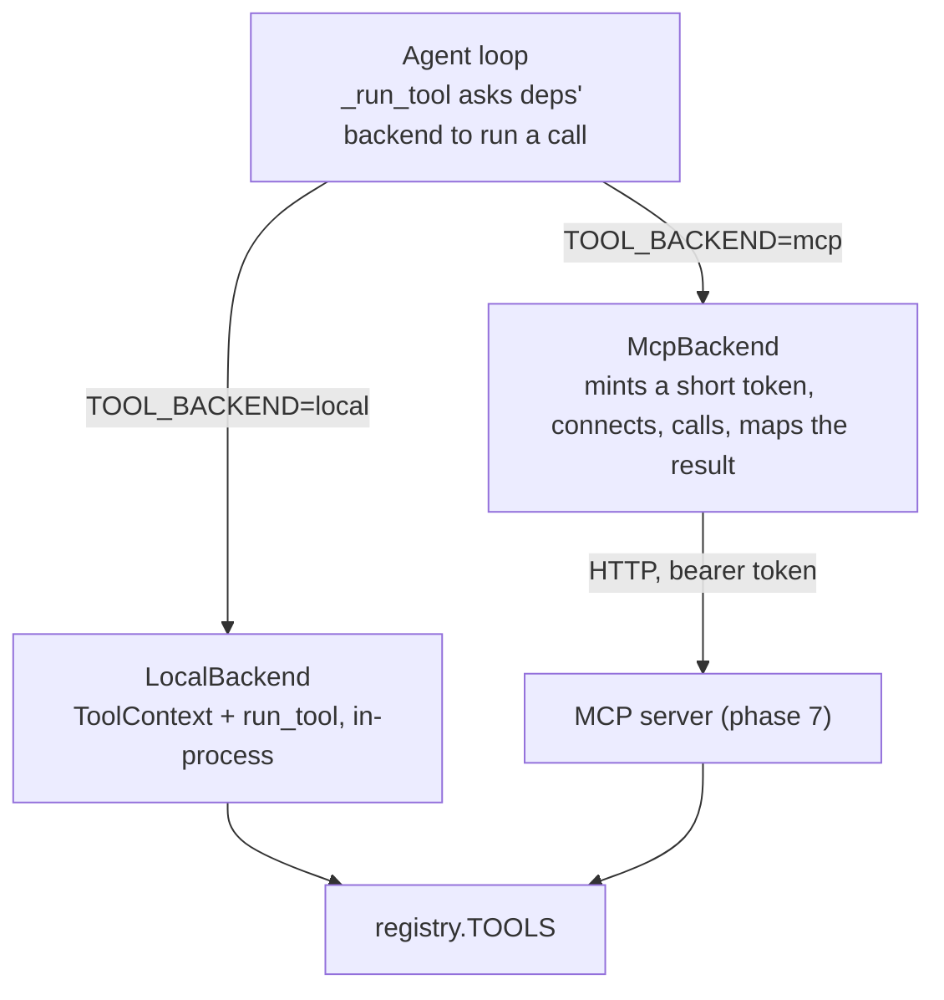

# Phase 8: The agent calls the tools over MCP

**Status:** planned
**Gate:** the existing tests pass unchanged on `local`; the loop's tool cases pass on `mcp`; one chat turn through the API works end to end with `TOOL_BACKEND=mcp`

This is phase 2 of `MCP_DESIGN.md`. Phase 7 built the server; this file says how the agent starts using it.

## Goal

Let the agent loop run its tool calls either in-process, as today, or through the MCP server, chosen by one setting, `TOOL_BACKEND=local|mcp`. The loop's logic does not change: it asks a backend to run a call and gets the same `ToolOutput` back. `local` stays the default, so the chat API, the demo and every existing test behave exactly as before.

By the end, a person can start `make mcp` and the API with `TOOL_BACKEND=mcp`, send a chat message that needs a tool, and see the call arrive at the server as that customer. Handling a server that is slow, down, or gone after it acted is phase 9; this phase has only a cautious stand-in for it (see "Failures in this phase").

## Deliverables

- [x] **Setting**: `TOOL_BACKEND` (`local` or `mcp`, default `local`) in the settings and `.env.example`
- [x] **Short-lived tokens**: `create_token` takes an optional lifetime, so the agent can ask for a few minutes instead of the login lifetime
- [x] **`ToolBackend`**: a one-method interface for running a tool call as a customer, and `LocalBackend`, which is today's `_run_tool` moved out of the loop with no change in behavior
- [x] **`McpBackend`**: runs a call through the MCP server as the customer, and returns the `ToolOutput` the server's result maps back to
- [x] **Loop**: `AgentDeps` takes an optional backend; the loop uses it, and builds a `LocalBackend` from the deps it already has when there is none
- [x] **API**: the chat endpoint picks the backend from the setting
- [ ] **Tests**: the loop's tool cases on both backends, the backend itself against the real app and real tokens, and the choice made by the setting
- [ ] **End-to-end check**: one real chat turn through the API with `TOOL_BACKEND=mcp`, written up under "Gate check"

## What the earlier phases already give

- The loop reaches tools in exactly one place, `_run_tool` in `loop.py`, which builds a `ToolContext` and calls `run_tool`. Everything after it (the trace span, `calls_made`, receipts, the citation bookkeeping for `search_knowledge`, the saved tool message) works on the `ToolOutput` it returns
- `ToolOutput(text, status, receipt)` is already the whole contract. `mapping.from_call_result` (phase 7) turns an MCP result back into one, and a test pins that the round trip loses nothing
- The tool schemas the model sees come from `tool_schemas()`, held in `TOOL_SCHEMAS` in the loop. They do not depend on where the tools run
- The server checks a bearer token on every request and runs the call as that customer, so the agent only has to present the right token
- `AgentDeps` is built in three places: the chat endpoint, `evals/agent_eval.py`, and the tests. A new field with a default changes none of them
- `_hand_over` (out of steps or out of time) opens its escalation ticket with `open_ticket` directly, not through a tool. It is not a tool call and stays as it is (see decisions)

## Architecture



## The interface

```python
class ToolBackend(Protocol):
    async def run(self, customer: CurrentCustomer, call: ToolCall) -> ToolOutput: ...
```

It takes the customer and the call as the loop has them and gives back a `ToolOutput`. It does not include the schemas: the model is told about the tools from the registry whichever backend runs them, so the loop does not need the server to be up to talk to the model.

| Backend | What `run` does |
| --- | --- |
| `LocalBackend(sessions, embedder, clock)` | Opens a session, builds a `ToolContext` for the customer and calls `run_tool`. This is the body of today's `_run_tool`, moved |
| `McpBackend(url)` | Mints a short-lived token for the customer, opens an MCP client to `url` with it, calls the tool, and maps the result with `from_call_result` |

`AgentDeps` gets `tools: ToolBackend | None = None`. The loop calls `deps.tools`, or a `LocalBackend` built from `deps.sessions`, `deps.embedder` and `deps.clock` when it is `None`. Nothing that builds `AgentDeps` today has to change.

## The MCP backend

**Identity.** The agent process holds the same `JWT_SECRET` as the API and the server, so it mints the token itself: `create_token(customer.id, lifetime=...)`, a few minutes. It does not forward the request's token, because a turn outlives the HTTP request that started it and the evals have no request at all. The customer id comes from the `CurrentCustomer` the loop already has, never from the model.

**Connection per call.** Each call opens a connection, calls, and closes it. That costs a handshake each time and buys simplicity: no pool, no session to expire, no chance of one customer's connection serving another. Phase 10 measures the cost; a connection per turn is the next step if it matters.

**Arguments.** `call.arguments` is the JSON string the model wrote, and an MCP call carries an object. The backend parses it; text that is not a JSON object comes back as `invalid_request` without contacting the server. The wording of that one message differs from the in-process one (which is Pydantic's), and the model only sees it when it sent malformed JSON.

**The result.** `from_call_result(result)` gives the `ToolOutput`, so the text, status and receipt reach the loop as they do today.

**Testing without a socket.** `McpBackend` takes the way it builds its HTTP client as a parameter. The tests give it the real server app behind an ASGI transport, so a real token goes through the real middleware, as in `test_mcp_auth.py`.

## Failures in this phase

A transport failure (server down, connection dropped, a timeout from the SDK's defaults) must not look like "nothing was changed", because after a call is sent the server may already have committed. Until phase 9 gives that case its own outcome, `McpBackend` turns any such failure into an `error` result whose message says the step may or may not have been done and must not be assumed either way, with no receipt. This is cautious but not complete: the SDK's default timeouts are 30 seconds to connect and 5 minutes to read, so a stalled server can stall a turn that long, and the turn's own deadline is only checked between steps. That is why `TOOL_BACKEND` stays `local` by default and why phase 9 follows.

## Configuration

| Setting | Default | Used by |
| --- | --- | --- |
| `TOOL_BACKEND` | `local` | The chat endpoint, to pick a backend |
| `MCP_SERVER_URL` | `http://localhost:8765/mcp` | `McpBackend` (added in phase 7) |

## Tests

| Test | Checks |
| --- | --- |
| Existing suite on `local` | Every test that passed before passes unchanged. This is the gate for the refactor |
| `create_token` lifetime | A token made with a lifetime expires then; with none, it lasts the login lifetime as before |
| `LocalBackend` | Gives the output `run_tool` gives for the same call, and opens its own session |
| `McpBackend` against the app | A lookup, a refund with its receipt, a denied refund and an invalid call give the same `ToolOutput` as `LocalBackend` (the cases of `test_mcp_tools.py`, with a real token) |
| Identity | The token the backend mints is for the loop's customer: a call as Priya cannot read Alex's order |
| Malformed arguments | Text that is not a JSON object gives `invalid_request` and no request reaches the server |
| Transport failure | A server that is not there gives an `error` result that does not say "nothing was changed" and has no receipt |
| Loop on `mcp` | The loop's tool cases (a tool call then an answer, a refund then a model failure that reports the receipt, the step limit) pass with `McpBackend` |
| Setting | `TOOL_BACKEND=mcp` gives the chat endpoint an `McpBackend`; `local` and unset give `LocalBackend`; anything else is refused at start-up |

## Build order

1. The `TOOL_BACKEND` setting and `.env.example`
2. `create_token` with a lifetime, and its test
3. `ToolBackend` and `LocalBackend`; the loop uses them. No test changes: the existing suite is the check, and this step is committed on its own
4. `McpBackend` and its tests against the app
5. The chat endpoint picks the backend from the setting, and its test
6. The loop's cases on `mcp`
7. The end-to-end check, written into this file

## Gate check

To fill in when the phase is done.

## Decisions to confirm

- **A token per call or a connection per turn.** Proposed: a connection and a token per call, for simplicity; measure in phase 10
- **Mint the token or forward the request's.** Proposed: mint, for the reasons above. The cost is that the agent process must hold `JWT_SECRET`, which the API already does
- **Where the model's tool list comes from.** Proposed: the registry, for both backends. Fetching it from the server (`tools/list`) is how MCP is normally used, and is the change that would let the tools move out of the backend later
- **The hand-over ticket.** It is written by the loop with `open_ticket`, straight to the database, whichever backend runs the tools. Proposed: leave it, and list it as the one place the agent still reaches the tool code directly
- **Evals.** `evals/agent_eval.py` keeps using the local backend in this phase. Proposed: phase 10 adds the flag and the comparison

## Not in this phase

- Per-call timeouts, the `unknown` outcome, and the loop's messages for it (phase 9)
- The agent eval on both backends and the latency numbers (phase 10)
- Idempotency keys for `issue_refund`
- Pooling or reusing connections
- Fetching the tool list from the server
- Moving the tool code out of the backend package
